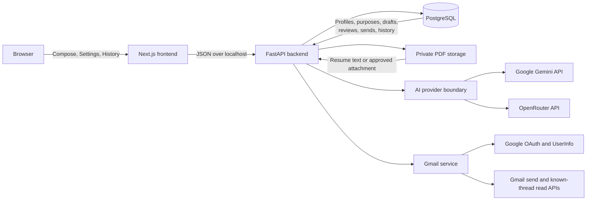

# RecruitFlow AI

RecruitFlow AI is a local-first web application for personalized recruiter outreach. It grounds AI-generated drafts in a selected resume, reusable outreach purpose, and job context. Manual review is the default; an explicit opt-in mode offers one-click AI generation and immediate Gmail sending for initial outreach, with no background or scheduled dispatch.

<!-- Screenshot placeholder: Compose, refinement, and final review workflow -->
<!-- Screenshot placeholder: Settings, resumes, purposes, and Gmail connection -->
<!-- Screenshot placeholder: Sent history and Gmail-threaded follow-ups -->

## Implemented capabilities

- Generate structured recruiter emails from a saved sender profile, selected PDF resume, outreach purpose, recipient details, and optional job description.
- Manage multiple private resumes and reusable, editable purposes such as cold outreach, referral requests, already-applied notes, and reconnections.
- Edit persisted drafts or ask AI to refine the current subject and body with a free-text instruction; revisions are proposed separately and never silently overwrite the draft.
- Use direct Google Gemini or OpenRouter through a shared provider boundary, with optional one-at-a-time failover for eligible temporary provider failures.
- Connect a verified Gmail identity with OAuth 2.0 and send plain-text email, optionally with the selected PDF attached.
- Use the default immutable review and per-message approval flow, or explicitly click `Generate & Send Email` to generate and immediately send one initial-outreach email without preview.
- Browse RecruitFlow send history, distinguish confirmed from uncertain delivery, and create contextual follow-ups in the original Gmail thread.
- Manually sync recruiter replies only from Gmail thread IDs already saved by RecruitFlow, then view incoming and outgoing messages chronologically with local new-reply indicators.
- Generate a grounded AI response to the latest eligible recruiter reply, edit or refine it in Compose, and send it in the same Gmail thread only after the normal final review and explicit approval.
- Remove drafts or entire conversations from RecruitFlow locally without deleting or changing messages in Gmail.
- Keep manual approval as the default, with optional one-click initial outreach protected by persisted opt-in, per-request consent, idempotency, daily limits, and the existing Gmail send state machine.
- Keep global inbox scanning, automated outreach, scheduling, and background sending out of scope.

## Architecture



AI keys, the OAuth client secret, and OAuth tokens remain backend-only. FastAPI owns validation, provider calls, Gmail authorization, approval enforcement, persistence, and access to private resume files.

## Tech stack

| Area | Implementation |
| --- | --- |
| Frontend | Next.js 16, React 19, TypeScript 5.9, Tailwind CSS 4 |
| Backend | Python 3.12, FastAPI, Pydantic Settings, Uvicorn, HTTPX |
| Data | PostgreSQL 16, SQLAlchemy 2, Psycopg 3, Alembic |
| AI | Google Gemini `generateContent`, OpenRouter chat completions, PyPDF text extraction |
| Email | Google OAuth 2.0, OpenID Connect user info, Gmail send and known-thread read APIs, Python MIME tooling |
| Security | Fernet token encryption, hashed OAuth state, private generated resume storage keys |
| Testing | pytest with PostgreSQL integration tests; TypeScript type checking and Next.js production builds |

Pinned dependency versions are available in [`backend/requirements.txt`](backend/requirements.txt) and [`frontend/package.json`](frontend/package.json).

## Engineering details

- **Grounded, structured AI output:** the shared prompt treats resume text, job descriptions, purposes, and refinement guidance as untrusted source data. Both providers must return a bounded object containing exactly `subject` and `body`, which is validated before persistence.
- **Controlled provider failover:** failover is disabled by default. When enabled with a distinct provider, the backend tries it exactly once after a primary-provider rate limit, transport timeout, or confirmed upstream 5xx response. Authentication, configuration, input, and malformed-output failures do not trigger failover. OpenRouter rejects models that are not explicitly free.
- **Protected Gmail credentials:** OAuth requests only `openid`, `userinfo.email`, `gmail.send`, and `gmail.readonly`. One-time, expiring OAuth state is stored as a hash; access and refresh tokens are Fernet-encrypted in PostgreSQL and never returned to the frontend. Existing send-only connections are never treated as read-authorized.
- **Server-enforced approval:** preparing a review snapshots the authenticated sender, recipient, subject, body, draft fingerprint, and attachment metadata. The attachment size and SHA-256 digest are checked again at dispatch. Any intervening draft or conversation change makes the review stale.
- **Duplicate-send prevention:** PostgreSQL uniqueness constraints, row locks, and durable `pending -> sending -> sent|failed|uncertain` transitions prevent the same approval from being dispatched twice by concurrent requests.
- **Conservative delivery state:** Gmail confirmation is required before a send becomes `sent`. An ambiguous timeout or transport failure after dispatch becomes non-retryable `uncertain`; the UI instructs the user to check Gmail Sent mail instead of blindly retrying.
- **Threaded follow-ups and bounded reply sync:** follow-ups retain Gmail thread IDs and RFC `Message-ID` values, supply `In-Reply-To` and `References`, and are rejected when same-thread delivery cannot be safely established. Reply sync is manual, reads at most 25 known non-deleted RecruitFlow threads per request, stores bounded plain text, and never searches the inbox, downloads attachments, changes labels, or marks Gmail messages read.
- **Inbound-context-bound AI replies:** the latest eligible received-message ID and a content fingerprint are bound to the immutable send review. Newer, changed, removed, cross-thread, self-authored, alias, or unsupported group context is rejected. The recipient comes from validated Gmail state, never AI output, and every response still requires manual approval.
- **Durable local deletion:** draft and conversation tombstones hide deleted records from normal APIs while preserving send snapshots, Gmail thread identifiers, and duplicate-send safeguards. Pending reviews become stale, active dispatches cannot be deleted, and no delete operation calls Gmail. Future synchronization must honor the root conversation tombstone.
- **Controlled one-click dispatch:** persisted preferences default every owner to manual mode. In automatic initial-outreach mode, one explicit `Generate & Send Email` click reserves a durable idempotency key, generates validated grounded content, binds the exact recipient/Gmail identity/attachment checksum, and uses the shared Gmail snapshot, MIME, locking, duplicate-prevention, and uncertain-delivery state machine. AI/pre-dispatch failures consume no claim; uncertain delivery consumes the claim and cannot be retried automatically. Follow-ups and received-message replies remain manual in the main UI. There is no scheduler, background worker, bulk campaign, or automatic reply dispatch.

## Local setup on Windows

### Prerequisites

- Python 3.12
- Node.js 20.9 or newer
- Docker Desktop with Docker Compose
- Windows PowerShell
- A Google AI Studio API key or an OpenRouter key configured for an explicitly free model
- A Google Cloud OAuth Web application if Gmail sending will be tested

Run these commands from the repository root unless the command changes directory.

### 1. Create local configuration and install dependencies

```powershell
Copy-Item .env.example .env
Copy-Item backend/.env.example backend/.env
Copy-Item frontend/.env.example frontend/.env.local

# Reuse an existing virtual environment; create one only when absent.
if (-not (Test-Path .venv)) { py -3.12 -m venv .venv }
& .\.venv\Scripts\python.exe -m pip install -r backend\requirements-dev.txt

Set-Location frontend
npm.cmd ci
Set-Location ..
```

All copied environment files are ignored by Git. The committed examples contain placeholders only. Private resumes default to the ignored `data/resumes/` directory.

### 2. Configure an AI provider

Edit `backend/.env`. Gemini is the local default:

```dotenv
AI_PROVIDER=gemini
GEMINI_API_KEY=replace-with-your-key
GEMINI_MODEL=gemini-3.5-flash-lite
AI_FALLBACK_ENABLED=false
AI_FALLBACK_PROVIDER=openrouter
```

To use OpenRouter as the primary provider, set `AI_PROVIDER=openrouter`, provide `OPENROUTER_API_KEY`, and use `openrouter/free` or a model ID ending in `:free` for `OPENROUTER_MODEL`.

To enable optional failover, set `AI_FALLBACK_ENABLED=true`, choose the distinct fallback in `AI_FALLBACK_PROVIDER`, and configure that provider's key and model as well. There is no paid fallback or recursive retry. The application cannot verify a Google project's billing tier; confirm Free Tier status in Google AI Studio before use.

### 3. Configure Google OAuth

In Google Cloud:

1. Enable the Gmail API.
2. Configure the OAuth consent screen; if it is in Testing, add the Gmail account as a test user.
3. Create an OAuth 2.0 client with application type **Web application**.
4. Add this exact authorized redirect URI:

```text
http://localhost:8001/api/gmail/oauth/callback
```

RecruitFlow requests only:

- `openid`
- `https://www.googleapis.com/auth/userinfo.email`
- `https://www.googleapis.com/auth/gmail.send`
- `https://www.googleapis.com/auth/gmail.readonly`

An existing Gmail connection created before reply sync was added must be reconnected from History so Google can grant `gmail.readonly`. RecruitFlow continues to distinguish a valid send-only connection from one authorized to read known threads.

Generate a Fernet key once:

```powershell
& .\.venv\Scripts\python.exe -c "from cryptography.fernet import Fernet; print(Fernet.generate_key().decode())"
```

Add the OAuth values to `backend/.env`:

```dotenv
FRONTEND_ORIGIN=http://localhost:3000
GMAIL_OAUTH_CLIENT_ID=replace-with-your-web-client-id
GMAIL_OAUTH_CLIENT_SECRET=replace-with-your-client-secret
GMAIL_OAUTH_REDIRECT_URI=http://localhost:8001/api/gmail/oauth/callback
GMAIL_TOKEN_ENCRYPTION_KEY=replace-with-the-generated-fernet-key
```

Retain the Fernet key while a Gmail connection exists; changing it makes stored tokens unreadable.

### 4. Start PostgreSQL and apply migrations

```powershell
docker compose up -d postgres
docker compose ps

Set-Location backend
& ..\.venv\Scripts\python.exe -m alembic upgrade head
Set-Location ..
```

### 5. Run the application

Use separate PowerShell terminals from the repository root.

Backend — `http://localhost:8001`:

```powershell
Set-Location backend
& ..\.venv\Scripts\python.exe -m uvicorn app.main:app --reload --host 127.0.0.1 --port 8001
```

Frontend — `http://localhost:3000`:

```powershell
Set-Location frontend
npm.cmd run dev
```

The backend health endpoint is `http://localhost:8001/api/health`. Stop PostgreSQL without deleting its named volume with `docker compose down`.

## Testing

Backend tests use PostgreSQL, mock all AI/Gmail calls, and refuse to run against a database whose name does not end in `_test`. By default, the fixture derives and creates `<DATABASE_URL database>_test`.

```powershell
docker compose up -d postgres

Set-Location backend
& ..\.venv\Scripts\python.exe -m pytest
& ..\.venv\Scripts\python.exe -m alembic check

Set-Location ..\frontend
npm.cmd run typecheck
npm.cmd run build
Set-Location ..
```

Latest verified backend result: **193 tests passed**, with Alembic reporting no schema drift. No live Gemini, OpenRouter, or Gmail requests are made by the automated tests.

## Security limitations

RecruitFlow currently uses one server-selected `LOCAL_OWNER_ID`. This prevents clients from choosing an owner but is **not authentication or multi-tenant isolation**. The application is intended for local development on `127.0.0.1` and is not suitable for public deployment as implemented.

A public deployment would require real authentication and session authorization, per-request tenant isolation, HTTPS, production secret/key management and rotation, CSRF and cookie review, abuse controls, rate limiting, audit and retention policies, OAuth consent/security review, and end-to-end security testing. Manual sync stores bounded reply text locally for known RecruitFlow threads and AI reply generation sends the selected bounded conversation context to the configured provider. The app does not perform a global inbox scan, download attachments, detect replies in the background, or determine whether an uncertain send was delivered.

## Roadmap

- Production authentication, authorization, observability, privacy controls, accessibility review, and deployment runbooks.
- Future work may add optional scheduling only after additional authorization, cancellation, operational monitoring, and abuse-prevention design. It is not implemented. Received-message replies always retain the normal manual review and approval workflow.

Detailed product contracts and non-goals are maintained in [`docs/PROJECT.md`](docs/PROJECT.md).
